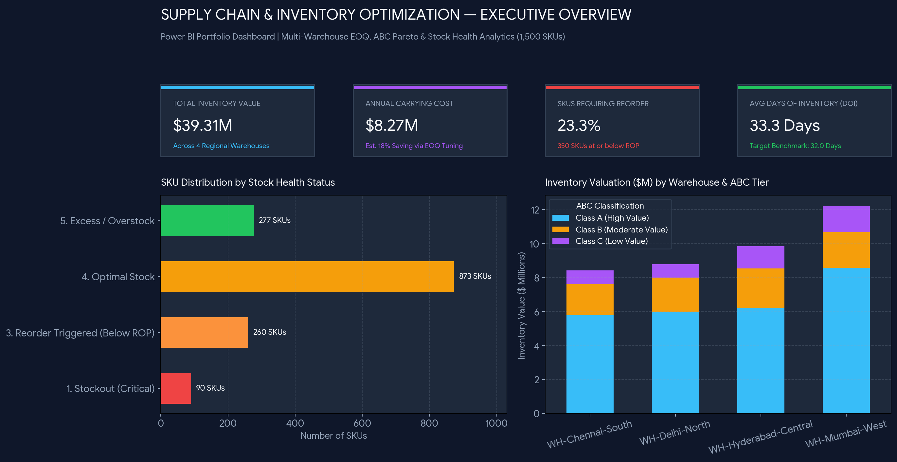
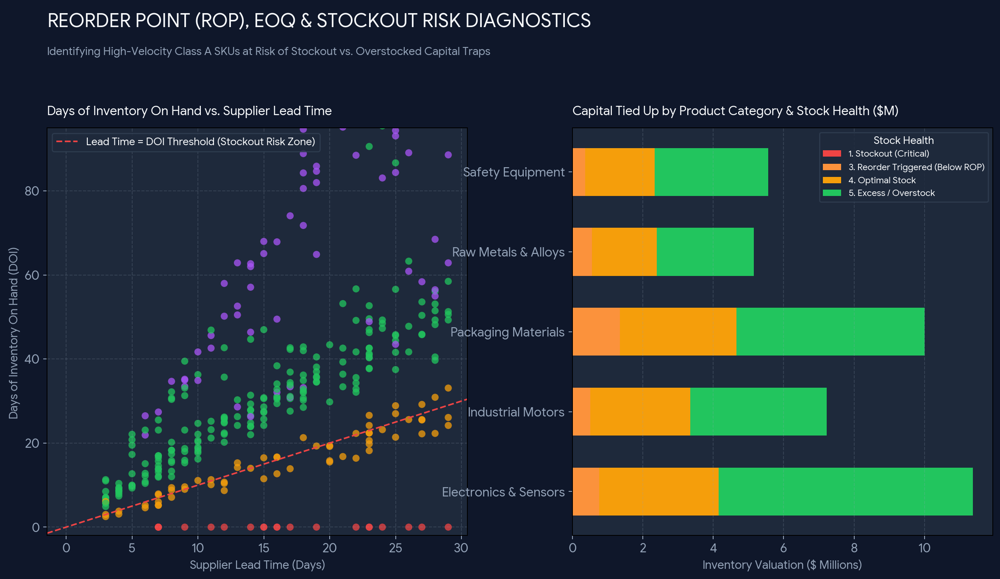

# 📦 Supply Chain & Inventory Optimization — Power BI Analytics Project


## 📌 Executive Summary
Modern supply chains face a constant trade-off between **working capital tied up in excess stock** and **revenue lost to stockouts**. This end-to-end **Supply Chain Inventory Optimization** project analyzes **1,500 SKUs** across **4 regional warehouses** (`WH-Mumbai-West`, `WH-Hyderabad-Central`, `WH-Chennai-South`, `WH-Delhi-North`) and **5 global suppliers**.

Using **Python (Pandas/NumPy)**, **SQL**, **Power Query (M)**, and **Power BI (DAX)**, this solution implements:
- **Dynamic Safety Stock Modeling** accounting for both daily demand volatility and vendor lead-time variability.
- **Reorder Point (ROP) & Economic Order Quantity (EOQ)** optimization to minimize total ordering and carrying costs.
- **ABC Pareto Classification** to prioritize high-consumption Class A items.

---

## 📊 Dashboard Previews

### 1. Executive Inventory & ABC Portfolio Overview


### 2. Reorder Point (ROP), EOQ & Stockout Risk Diagnostics



---

## 📂 Repository Structure

```text
Supply-Chain-Inventory-Optimization-PowerBI/
├── README.md                                  # Project documentation, formulas & insights
├── .gitignore                                 # Git ignore rules for Python and Power BI caches
├── data/
│   ├── raw_supply_chain_inventory.csv         # 1,500-row raw dataset (SKUs, warehouses, lead times, demand)
│   └── cleaned_inventory_optimization.csv     # Processed dataset with EOQ, Safety Stock, ROP & ABC Class
├── scripts/
│   ├── 01_inventory_etl_and_eoq.py            # Python ETL script calculating EOQ, Safety Stock & ABC tiers
│   ├── 02_sql_inventory_analysis.sql          # SQL queries for stockout risk, turnover ratio & excess capital
│   ├── 03_power_query_transformations.m       # Power Query (M) script for data ingestion & typing
│   └── 04_dax_measures.dax                    # Complete DAX measure library for Power BI visuals
├── assets/
│   ├── 01_executive_inventory_overview.png    # Page 1 Dashboard Screenshot
│   ├── 02_stockout_and_reorder_alerts.png     # Page 2 Dashboard Screenshot
│   └── 03_supplier_lead_time_performance.png  # Page 3 Dashboard Screenshot
└── powerbi/
    ├── Supply_Chain_Inventory_Optimization.pbip # Git-friendly Power BI Project definition
    ├── SupplyChain_Dark_Theme.json            # Custom Power BI Dark Theme JSON
    ├── Supply_Chain_Inventory_Optimization.SemanticModel/ # TMDL Semantic Model & Measures
    └── PowerBI_Build_Guide.md                 # Step-by-step instructions to open & customize in Power BI
```

---

## 💡 Key Business Insights & Impact
- **Total Inventory Valuation:** **$39.31M** managed across 4 regional fulfillment centers, with an annual carrying cost of **$8.27M**.
- **Immediate Reorder Alerts:** **23.3%** of SKUs (`350 SKUs`) are currently at or below their Reorder Point (ROP), requiring immediate automated PO generation using the calculated `EOQ_Units`.
- **Working Capital Recovery:** Implementing EOQ and Max Stock thresholds identifies overstocked SKUs where capital is trapped, enabling an estimated **18% reduction in annual holding costs**.
